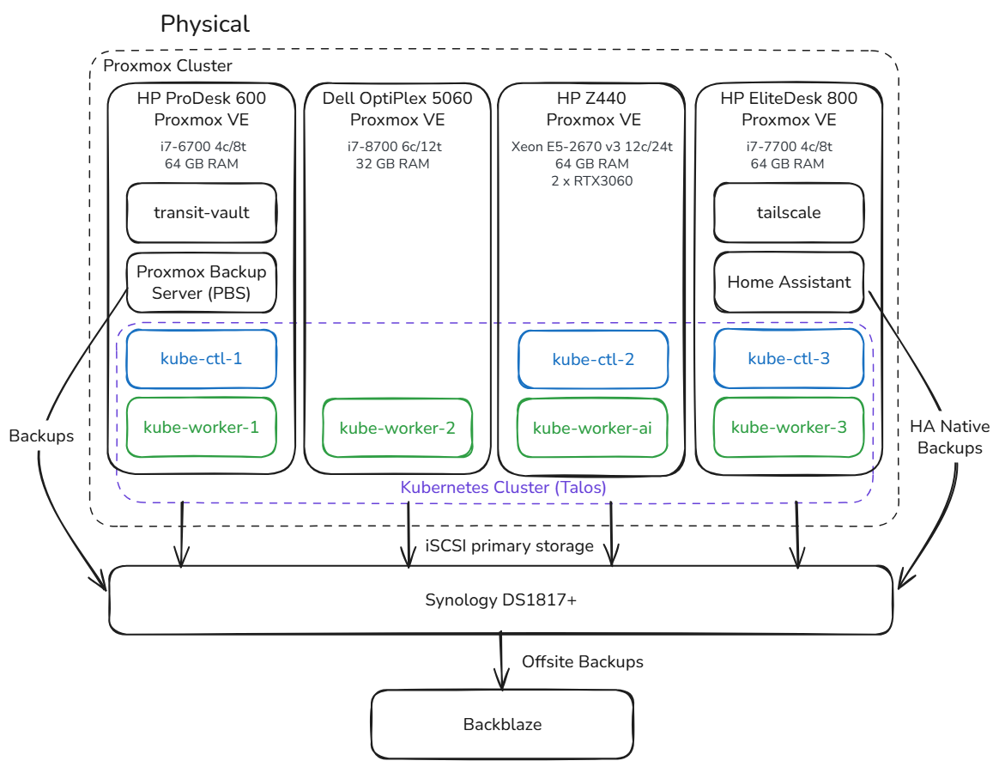
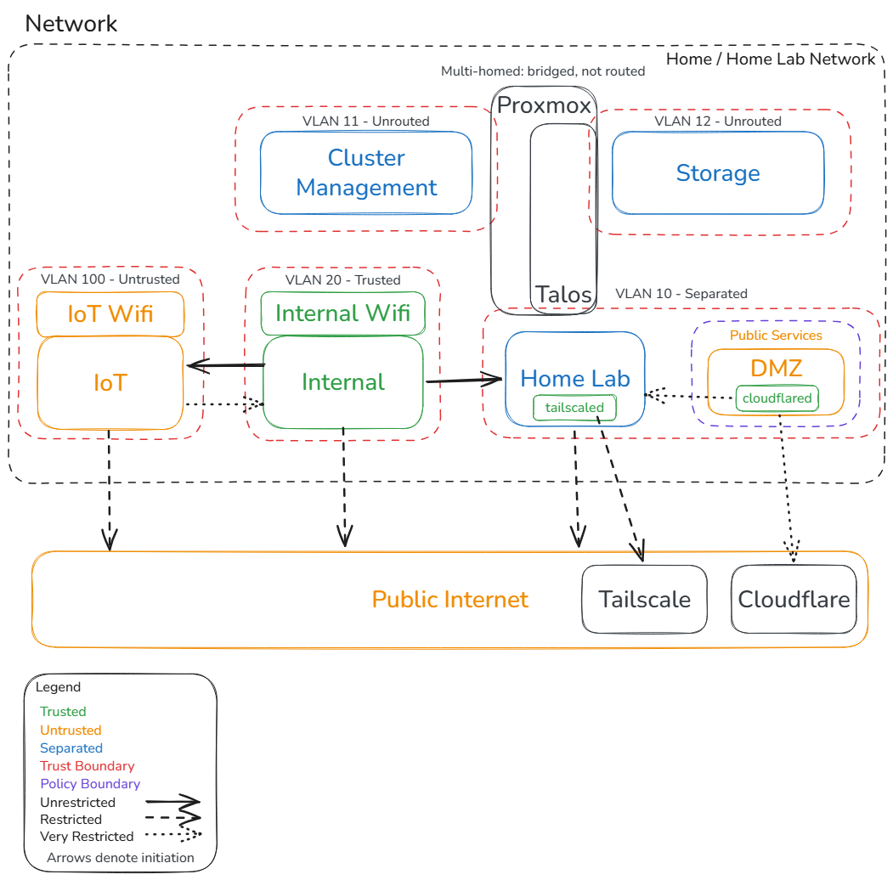
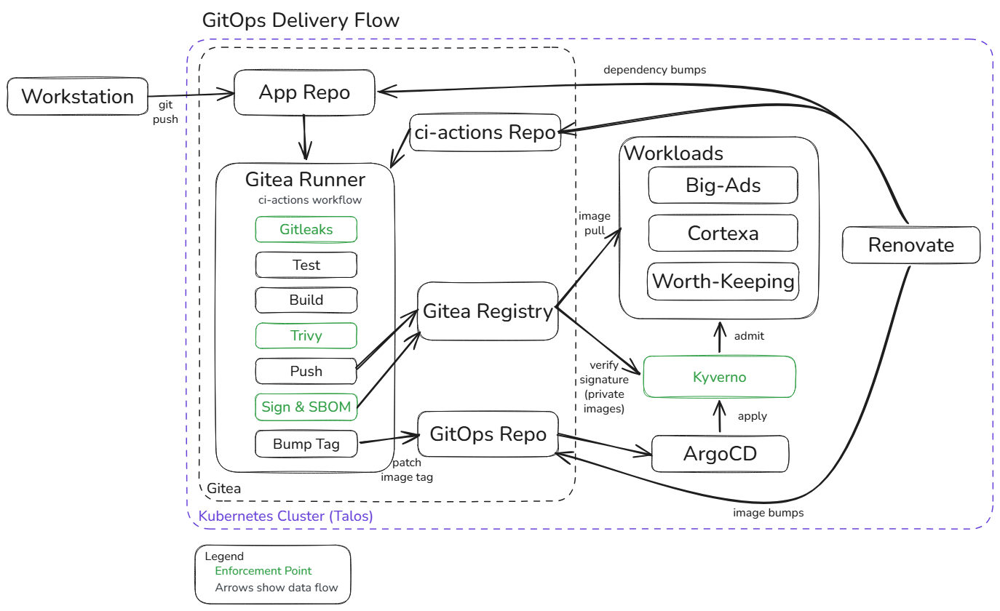
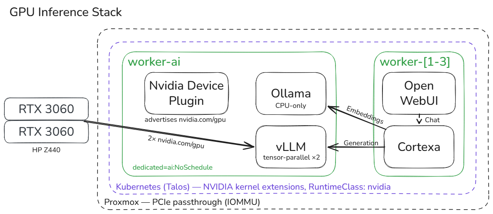

Diagrams are created in [Excalidraw](https://excalidraw.com).

---

## Physical Architecture

Four small workstations form a Proxmox cluster. The three HP machines each run one Talos control-plane VM and one worker, so no single box takes out quorum. The HP Z440's worker is the GPU node (`kube-worker-ai`), with dual RTX 3060s passed through for local LLM inference. The Dell OptiPlex 5060 (pve-4) joined in November 2026 with half the memory of the others. It carries one deliberately smaller worker and no control plane.

A few things run beside the cluster rather than in it, on purpose:

- **transit-vault**, an LXC on the ProDesk, holds the key that auto-unseals the cluster's Vault. A Vault can't unseal itself.
- **Proxmox Backup Server**, a VM on the ProDesk.
- **tailscale**, an LXC on the EliteDesk, which is the remote-access path that still works when the cluster doesn't ([ADR 015](../decisions/015-tailscale-remote-access/)).
- **Home Assistant**, a VM on the EliteDesk, with its own native backups.

Every node uses a Synology DS1817+ over iSCSI for primary storage, and the NAS also receives the PBS and Home Assistant backups. What can't be rebuilt goes one step further, to Backblaze B2 ([ADR 018](../decisions/018-offsite-backup/)).

---

## Network Layout

The network is segmented into trust zones. VLANs are enforced at the firewall, and the DMZ is a policy boundary inside the Home Lab VLAN:

| Zone | VLAN | Trust Level | Notes |
|---|---|---|---|
| Internal | 20 | Trusted | Primary LAN; unrestricted access to Home Lab |
| Internal WiFi | 20 | Trusted | Wireless extension of Internal |
| Home Lab | 10 | Separated | Kubernetes cluster traffic; the Tailscale subnet router lives here |
| IoT | 100 | Untrusted | Isolated; Internal can reach into it, while it can barely reach back |
| IoT WiFi | 100 | Untrusted | Wireless extension of IoT |
| DMZ | within 10 | Untrusted | Public services only; `cloudflared` holds the tunnel, and its path into the Home Lab is very restricted |
| Cluster Management | 11 | Separated | Proxmox cluster traffic (corosync); unrouted |
| Storage | 12 | Separated | iSCSI to the Synology; unrouted |

The two unrouted VLANs never touch the firewall at all. Instead, the machines that need them are **multi-homed**, bridged on rather than routed to. Proxmox hosts carry VLAN 11 for corosync, and each Talos node has a second NIC on VLAN 12 for iSCSI. Cluster heartbeats and storage traffic have no path to or from anywhere else.

**Two ingress paths, two jobs.** A **Cloudflare Tunnel** fronts the handful of deliberately public hostnames, terminating at `cloudflared` in the DMZ. A **Tailscale subnet router** advertises the LAN into a private tailnet, which is how I administer the platform remotely — no open inbound ports, and admin interfaces never reach the public internet at all. Neither path is a fallback for the other; the reasoning is in [ADR 015](../decisions/015-tailscale-remote-access/).

---

## Platform Capability Map

What runs on the platform, in seven areas. This one isn't a drawing because it isn't a picture of relationships; it's an inventory. Every highlighted component links to the decision record that explains why it's there, and the numbers say which one. Plain components are in use without a record of their own.

<!-- platform-map -->

| Area | Components |
|---|---|
| **GitOps & delivery** | Argo CD, Gitea, Gitea Runner, Renovate, Velero |
| **Networking & segmentation** | Cilium, Istio Ambient, MetalLB, Cloudflare Tunnel |
| **Data persistence** | CloudNativePG, Synology CSI, MinIO |
| **Observability** | Prometheus, Alertmanager, Pyrra, Grafana, six exporters, Uptime Kuma, Hubble, Kiali, Dozzle, Ntfy, metrics-server, Goldilocks |
| **Security & compliance** | Authentik (and its outpost), Vault, External Secrets, Kyverno, Tetragon, cert-manager, Falco, Trivy, Gitleaks, Checkov, kube-bench, Polaris |
| **Local AI platform** | vLLM, Ollama, NVIDIA device plugin, 11 MCP servers, Open WebUI |
| **User apps** | Cortexa, Worth Keeping, big-ads, big-recipes, big-weather, Paperless, Karakeep, Outline, Homepage, Wallos |

The bottom row matters as much as the grid. **Tailscale, the backup server, transit-vault and the offsite copy run beside the cluster on purpose**: each is something you need when the cluster is the thing that's broken. Tailscale gets you in ([ADR 015](../decisions/015-tailscale-remote-access/)), PBS and Backblaze get the data back ([ADR 012](../decisions/012-layered-backup-strategy/), [ADR 018](../decisions/018-offsite-backup/)), and transit-vault unseals the cluster's Vault, which can't unseal itself.

---

## GitOps Delivery Flow

How a change actually reaches production. The distinctive part is the **two-repository handoff**: CI doesn't deploy anything. It builds an image, pushes it to the in-cluster registry, then **clones the GitOps repo and patches the image tag** in the deployment manifest. ArgoCD notices the manifest change and reconciles. Nothing is ever applied directly to the cluster.

Every app repo runs the same pipeline, pulled from one shared **ci-actions** repo rather than copied into each. The green boxes are where something can say no:

- **Gitleaks** stops a commit with a secret in it.
- **Trivy** scans the image before it's pushed. A failed scan means no push.
- **Sign & SBOM** signs every in-house image and attaches its bill of materials.
- **Kyverno** checks that signature at admission and refuses any private image that lacks it ([ADR 020](../decisions/020-signed-images-runtime-enforcement/)).

So an image that didn't come through this pipeline can't run, even if someone gets it into the registry.

Note where the boundary sits: the Git server, the runner, and the container registry all live **inside the cluster they deploy to**. That circularity is deliberate and its recovery implications are covered in [ADR 002](../decisions/002-self-hosted-gitea-ci/). Renovate feeds the same loop from three directions: dependency bumps to app repos, workflow bumps to ci-actions, and image bumps straight to the GitOps repo. A base-image bump travels the identical path as a hand-written commit.

[big-ads](../../projects/big-ads/) has shipped more than 100 releases through this pipeline with no manual steps.

---

## GPU Inference Stack

The layered chain behind local inference, and the reason it took real work to get right: **every boundary in this diagram is a layer that can fail silently and look like the next layer's problem.** PCIe passthrough with correct IOMMU grouping at the Proxmox layer, NVIDIA kernel extensions baked into a custom Talos image, the device plugin advertising `nvidia.com/gpu` to the scheduler, and finally CUDA inside the container. The `dedicated=ai:NoSchedule` taint keeps everything else off the node.

Both RTX 3060s are driven as one pool: vLLM runs **tensor-parallel across the pair** and claims both GPUs, which is what makes a quantized 35B mixture-of-experts model fit at all. Ollama stays on the node but runs on CPU, serving only embeddings. The two runtimes divide the work rather than share the silicon ([ADR 014](../decisions/014-vllm-inference/)).

Nothing a person talks to runs on the GPU node. Open WebUI and [Cortexa](../../projects/cortexa/) sit on the general workers. Chat goes from Open WebUI to Cortexa, which calls vLLM's OpenAI-compatible API for generation and Ollama for embeddings.
