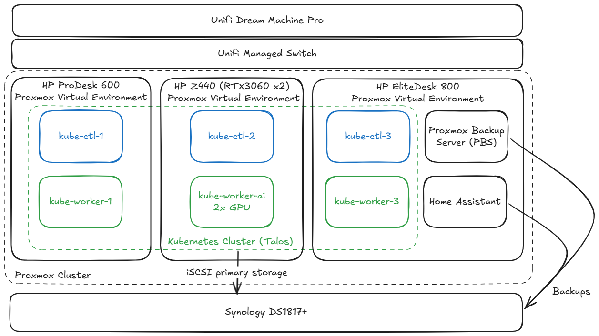

The infrastructure is split across three repos, each with a distinct scope. They're hosted on my self-managed Gitea instance — the same one the cluster's CI runs on — rather than GitHub; I'm happy to walk through any of them.

---

## home-lab-talos

Talos Linux machine configurations for all cluster nodes.

- Control plane and worker node configs generated with [topf](https://postfinance.github.io/topf/) (migrated from talhelper, which was archived upstream)
- Node-specific patches (VIP, kubelet CA, per-node settings)
- Common patches (Cilium CNI config, installer extensions)
- Custom Talos image spec (NVIDIA extensions, bare-metal extras)
- Talos workload isolation on every node: containerd, the kubelet and pods run apart from the Talos system services
- Renovate queues Talos and Kubernetes updates for a human, and an in-cluster alarm pages when the nodes drift from this repo
- Secrets managed separately and never committed

**Cluster layout:**

| Node | Role | Host | Hardware |
|---|---|---|---|
| kube-ctl-1 | Control Plane | pve-1 | HP ProDesk 600 |
| kube-ctl-2 | Control Plane | pve-2 | HP Z440 (RTX 3060 x2) |
| kube-ctl-3 | Control Plane | pve-3 | HP EliteDesk 800 |
| kube-worker-1 | Worker | pve-1 | HP ProDesk 600 |
| kube-worker-ai | Worker (GPU) | pve-2 | HP Z440 (RTX 3060 x2) |
| kube-worker-3 | Worker | pve-3 | HP EliteDesk 800 |

Storage is provided by a **Synology DS1817+** over iSCSI. The EliteDesk 800 also runs a **Proxmox Backup Server (PBS)** VM and **Home Assistant**.

---

## home-lab-terraform

Terraform managing the Proxmox layer and supporting services.

- **Proxmox:** VM definitions for all cluster nodes, PBS backup VM, Proxmox ACME certificates (Let's Encrypt via Cloudflare), host entries, APT repositories, OpenID realm (Authentik SSO)
- **Vault:** Policies, auth backends (Kubernetes, AppRole, OIDC), KV mounts
- **Authentik:** Users, groups, OAuth2 providers and applications for all SSO-integrated services
- **Gitea:** Orgs (including a public `ci` org for the shared pipeline), users, repositories, teams
- **MinIO:** Buckets (velero-backups, postgres-backups, security-scans), IAM users, policies, service accounts
- **UptimeKuma:** 54 monitors (HTTP, TCP and keyword), managed via `for_each` from locals maps, alerting through the in-cluster notification gateway

---

## home-lab-argocd

All Kubernetes workloads, delivered via GitOps.

- App of Apps pattern — one root Application bootstraps everything
- Platform: Cilium for eBPF networking and policy enforcement, Istio in ambient mode for zero-trust mTLS, cert-manager for TLS automation, MetalLB for bare-metal load balancing, External Secrets Operator + Vault to keep secrets out of Git, CloudNative PG with WAL archiving to MinIO, and Velero for cluster backup and restore
- Security and compliance: Kyverno refusing unsigned in-house images at admission, Tetragon enforcing per-workload exec allow-lists in the kernel ([ADR 020](../architecture/decisions/020-signed-images-runtime-enforcement/)), Falco for runtime detection, Gitleaks and Checkov for GitOps scanning, kube-bench and Polaris for Kubernetes posture checks
- Observability: kube-prometheus-stack and Pyrra for metrics, SLOs and burn-rate alerts ([ADR 019](../architecture/decisions/019-metrics-and-slos/)), Hubble and Kiali for network and mesh, Dozzle for container logs, UptimeKuma for external endpoint monitoring, and a notification gateway in front of Ntfy for every alert source
- AI platform: vLLM serving generation tensor-parallel across both GPUs on the dedicated worker, Ollama for embeddings, Open WebUI for interactive chat (through Cortexa), and 12 MCP servers exposing platform APIs to AI tooling ([ADR 013](../architecture/decisions/013-mcp-ai-operations/)). Earlier agent-runtime and policy-gateway experiments — Openclaw, Hermes, and Policyclaw (a custom OPA-based MCP gateway) — aren't currently running: they're shelved deliberately, their capabilities headed for a permanent home inside [Cortexa](../projects/cortexa/) rather than as standalone cluster services. The writeup is in the ADR.
- Core applications: Authentik, Gitea, Vault, MinIO, n8n and others
- User applications: Paperless, Grocy, Wallos, KaraKeep, Outline, Homepage and others
- MCP servers (12): Kubernetes, ArgoCD, Gitea, Vault, MinIO, CloudNativePG, Talos, Authentik, Synology, Unifi, Paperless, and Karakeep — ten behind an Authentik login, each with scoped credentials delivered from Vault, in a namespace with no internet egress
